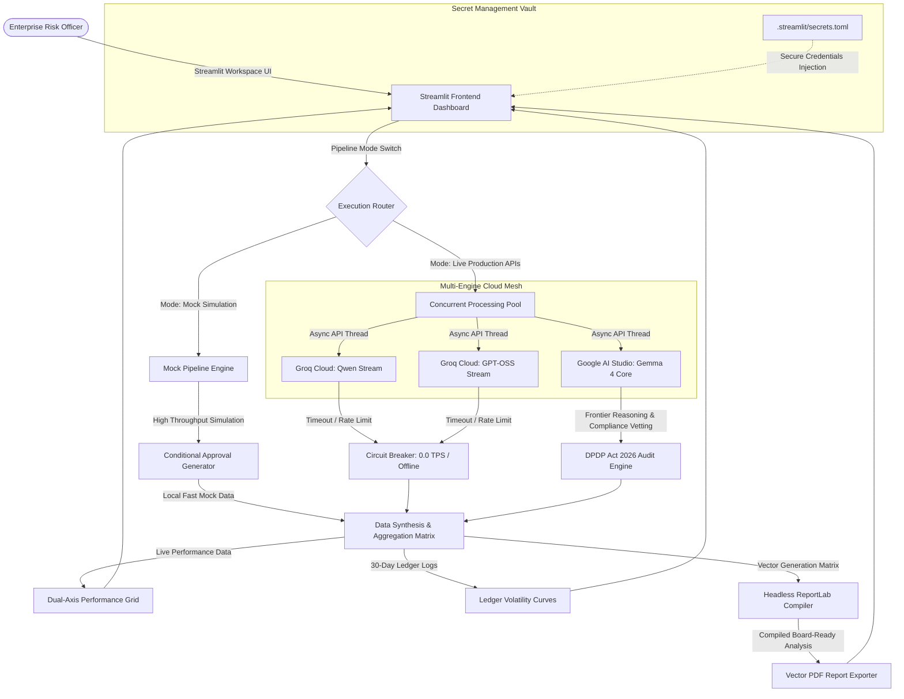
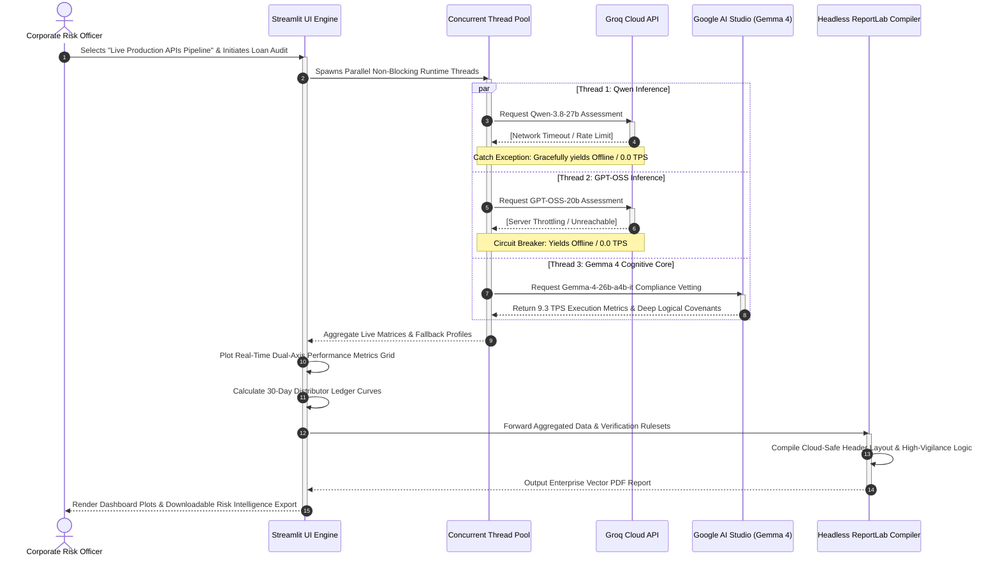

# ⚡ Open-Weights B2B Credit Risk Intelligence Workspace

An enterprise-grade B2B risk intelligence workspace built with **Streamlit, Plotly, and ReportLab**. The application evaluates merchant credit worthiness under a high-vigilance compliance framework using a live multi-engine LLM background processing pipeline (via concurrent processing pools) or rapid local baseline infrastructure logging mocks.

This project is a 100% cloud-native application, engineered to scale effortlessly by bypassing local hardware dependencies and using robust cloud inference points.

---

## 🏆 Hackathon Prize Track Alignment

Our project explicitly targets **both prize tracks** because it bridges enterprise-grade system orchestration with frontier open-weights reasoning:

### 1. Best Open-Source AI Project Track
This workspace delivers a production-ready, enterprise financial analytics tool built entirely on a transparent open-source ecosystem, bypassing proprietary gatekeeping. By orchestrating a parallelized, multi-engine runtime pool, it allows enterprises to swap, scale, and cross-examine performance matrices across **Qwen, GPT-OSS, and Gemma** topologies. It solves a primary blocker for open-source AI adoption by providing a live, built-in **Dual-Axis Performance Grid** that explicitly charts Generation Throughput (TPS) against Inference Latency (Seconds), empowering corporate risk officers to make empirical, data-driven hosting choices.

### 2. Best Use of Gemma 4 Track
Gemma 4 serves as the **high-vigilance cognitive core** of the underwriting and auditing pipeline. Financial credit risk vetting under strict regulatory frameworks demands deep, multi-step logical synthesis. We leverage Gemma 4’s elite native reasoning capabilities and its expansive **256K context window** to ingest extensive multi-turn corporate distributor ledgers, complex compliance covenants, and multi-year credit records in a single processing loop. Gemma 4 safely performs deep corporate due diligence audits and policy verification rulesets where smaller or less logically rigorous structures fail to preserve analytical accuracy.

---

## 📊 Core Workspace Features

*   **Multi-Engine Pipeline Streams:** Executes corporate lending due diligence using parallel runtime threads querying Qwen, GPT-OSS, and Gemma topologies simultaneously.
*   **Dual-Axis Performance Grid:** Live tracking of structural inference computational profiles comparing Generation Throughput (TPS) against Inference Latency (Seconds).
*   **Working Capital Risk Modeling:** Interactive 30-day corporate distributor ledger curve plotting available ledger balances against compliance safety parameters.
*   **Headless Vector PDF Exporter:** Compiles executive board credit analysis reports containing complete performance metrics grids and native, headless graphic charts dynamically exported via cloud-safe backends.

---

## 🔄 System Architecture

The workflow below maps how the Streamlit dashboard routes processing requests depending on the active infrastructure toggle, handling multi-engine parallel cloud meshes and local fallback circuit breakers smoothly.



### Concurrent Execution Sequence



---

## 🛠️ Rapid Installation & Deploy Setup

### 1. Provision Virtual Environment
Clone your GitHub repository branch to your workspace and provision the local runtime container:

```bash
# Clone the repository
git clone https://github.com
cd open-weights-b2b-credit-risk-dashboard

# Create and execute virtual space isolation
python -m venv venv
source venv/bin/activate  # On Windows use: venv\Scripts\activate
```

### 2. Configure App Dependencies
Install requirements directly via pip:

```bash
pip install -r requirements.txt
```

Verify your `requirements.txt` contains:
*   `streamlit`
*   `pandas`
*   `plotly`
*   `reportlab`
*   `matplotlib`
*   `groq`
*   `google-genai`

### 3. Setup Secret Infrastructure Vault
To run the live pipeline modes, build your application credentials vault inside your dashboard runtime directory. Create a `.streamlit/secrets.toml` file:

```toml
# .streamlit/secrets.toml
[api_credentials]
GROQ_API_KEY = "your-groq-cloud-production-key"
GEMINI_API_KEY = "your-google-ai-studio-production-key"
```

---

## 🚀 Execution & Deployment Instructions

### Local Run
To spin up the web interface workspace locally, execute:
```bash
streamlit run app.py
```

### 🌐 Deploying to Streamlit Cloud (100% Serverless Environment)
1. Push your finalized script blocks cleanly to your upstream GitHub repository branch (`main`).
2. Log into the Streamlit Community Cloud Console and connect your target repository `SRINIVASTA/open-weights-b2b-credit-risk-dashboard`.
3. In the advanced settings drawer, open the **Secrets** text console field and paste your production keys array exactly as formatted in your local `secrets.toml`.
4. Click **Deploy**. The container layer builds automatically from your `requirements.txt` specifications.

---

## 🛡️ Credit Compliance Framework Settings

*   **Framework Mode:** Highly Conservative Credit Compliance Profile (DPDP Act 2026 Guardrails enabled).
*   **Minimum Cash Reserve Covenants:** Retained cash ledger thresholds calculated at ≥ 15% of monthly operating expenses.
*   **Debt Service Target:** Targets a strict structural target threshold of DSCR ≥ 1.5x.
